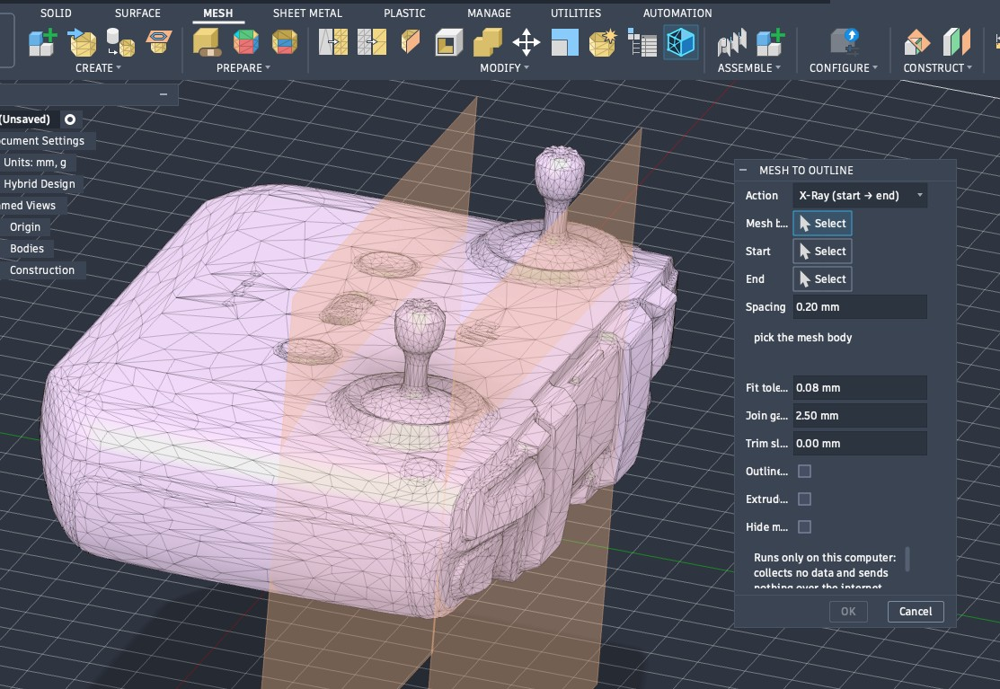

# Mesh to Outline for Autodesk Fusion

Turn a mesh into a sketch you can actually use. Pick a mesh body and a plane,
and Mesh to Outline draws the cut as real sketch lines, arcs, circles and
splines, not thousands of tiny segments.

- **Single slice:** one sketch on one plane.
- **Stack:** several sketches at a spacing you choose.
- **X-Ray:** a stack of sketches between a start and an end.
- **Extrude each slice:** turn a stack into one solid body.

It runs only on your computer. It collects no data and sends nothing over the
internet.

The [user guide](https://stltosolid.com/docs/fusion-add-in/) shows every
setting and walks through a full example.

## What you need

- A current version of Autodesk Fusion (with its built-in Python 3.14).
- macOS 15 or newer, or Windows 11.

## Install

1. Go to the [latest release](https://github.com/Crypto69/mesh-to-outline/releases/latest)
   and download the zip for your computer:
   `MeshToOutline-<version>-mac.zip` or `MeshToOutline-<version>-windows.zip`.
2. Unzip it.
3. Copy the `MeshSectionSketch` folder into Fusion's add-ins folder. Do not
   rename it.
   - **Mac:** `~/Library/Application Support/Autodesk/Autodesk Fusion 360/API/AddIns/`

     The `Library` folder is hidden. In Finder press **Cmd+Shift+G** and paste
     the path above.
   - **Windows:** `%APPDATA%\Autodesk\Autodesk Fusion 360\API\AddIns\`

     Paste that path into the File Explorer address bar.
4. In Fusion, open **Utilities → Add-Ins → Scripts and Add-Ins**, go to the
   **Add-Ins** tab, pick **MeshSectionSketch** and click **Run**. It starts with
   Fusion from then on.

The button is on the **Mesh** tab, in the **Modify** panel, next to Convert Mesh.

## Update

There is no auto-update. In Scripts and Add-Ins, stop the add-in. Delete the old
`MeshSectionSketch` folder, copy in the new one, then click **Run** again.

## If something goes wrong

- **The add-in is not in the list.** Check that the folder is called exactly
  `MeshSectionSketch`, and that `MeshSectionSketch.manifest` is directly inside
  it, not one folder deeper.
- **"Autodesk Fusion has updated its Python."** Install the latest release.
- **"Mesh to Outline is incomplete."** The download is damaged or is for the
  other kind of computer. Install the zip for your computer again.
- **"Another add-in has loaded an old copy of numpy."** Turn that add-in off,
  restart Fusion and try again.
- **"Empty cut skipped."** The plane misses the mesh there.
- **"WARNING: the outline did not close in N slices."** The mesh has holes wider
  than *Join gaps* at those slices. Raise *Join gaps* to the value the warning
  gives and run again.
- **Two MeshSectionSketch rows in the list.** It is the same folder seen twice.
  Run only one of them.

Still stuck? [Open an issue](https://github.com/Crypto69/mesh-to-outline/issues).
Please include your Fusion version, your operating system, and the lines in the
Text Commands palette that start with `MeshSectionSketch:`.

## Licence

Free for non-commercial use, under the
[PolyForm Noncommercial License 1.0.0](LICENSE). numpy comes inside the zip,
under its own licence: see `THIRD-PARTY-NOTICES.txt` in the zip.

## Contributing

Bug fixes and feature improvements are welcome. Open an issue or send a pull
request. [DEVELOPING.md](DEVELOPING.md) shows how to set up and run the tests.

By sending a pull request, you agree that Chris Venter may also release your
code under other licences, such as the Autodesk store's or a commercial licence.

Part of [stlToSolid](https://stltosolid.com). Not affiliated with or endorsed by
Autodesk. Autodesk and Autodesk Fusion are registered trademarks or trademarks of
Autodesk, Inc., and/or its subsidiaries and/or affiliates.
